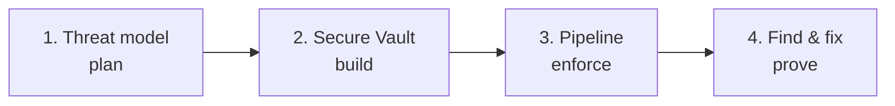

# Hi, I'm Funso 👋

**Application security & DevSecOps** · Security+ · Network+ · M.S. Cybersecurity candidate at NYU Tandon

I like understanding how things break, so I can build them so they don't. Most of my work sits where security meets software: threat modelling an app before it's built, scanning it while it's being built, and making sure nothing risky ships.

📍 Douglasville, GA · [LinkedIn](https://linkedin.com/in/funisola) · [funisola@gmail.com](mailto:funisola@gmail.com)

---

## Right now

- **Cybersecurity Intern at Cordros Capital.** I run SAST and DAST scans with OWASP ZAP and SonarQube, analyse network traffic in Wireshark, and manage firewall rules on Sophos NGFW.
- **Studying for my M.S. in Cybersecurity** at NYU Tandon (expected May 2027). My B.S. in Information Security is from Kennesaw State University.
- **Building in public** on the projects below.

---

## 🔐 Featured work: one app, secured end to end

Instead of four unrelated demos, I built one realistic project and secured it at every stage, the way a security team would at a real company.

<table>
<tr>
<td width="50%" valign="top">

### [Secure Vault](https://github.com/funsoi-hub/secure-vault)
An encrypted notes and file vault where even a stolen database gives an attacker nothing. Each user gets their own encryption key, plus two-factor sign-in and share links that expire.

**37 security tests**, mapped to the OWASP Top 10.

`Python` `FastAPI` `AES-256-GCM` `Argon2id` `Docker`

</td>
<td width="50%" valign="top">

### [Threat Model](https://github.com/funsoi-hub/secure-vault-threat-model)
Every way I could find to attack the vault, written before the code: **35 threats**, each linked to the control that stops it, with attack trees and real attacker techniques.

`STRIDE` `MITRE ATT&CK` `Cyber Kill Chain` `Mermaid`

</td>
</tr>
<tr>
<td width="50%" valign="top">

### [DevSecOps Pipeline](https://github.com/funsoi-hub/devsecops-pipeline)
A reusable GitHub Actions security gate that scans code, secrets, dependencies, containers and the running app, and **blocks the merge** on anything serious. It caught 5 high-severity CVEs on its very first run.

`GitHub Actions` `Semgrep` `Bandit` `Gitleaks` `Trivy` `OWASP ZAP`

</td>
<td width="50%" valign="top">

### [Find & Fix: PyGoat RCE](https://github.com/funsoi-hub/pygoat/blob/fix/command-injection-lab/dockerized_labs/command_injection_lab/SECURITY_FIX.md)
Found, proved and fixed a **critical (CVSS 9.8)** remote-code-execution flaw in an OWASP training app. I also found a bypass in the lab's own suggested fix. 38 tests prove the fix.

`Command injection` `CWE-78` `Python` `pytest`

</td>
</tr>
</table>

---

## 🧰 Toolbox

**Security testing:** OWASP ZAP · SonarQube · Semgrep · Bandit · Trivy · Gitleaks · Wireshark · Splunk

**Build & automate:** Python · FastAPI · Flask · Docker · GitHub Actions · Git · PowerShell · Bash

**Infrastructure:** Linux & Windows administration · Active Directory · Sophos NGFW · Networking

**Frameworks I work with:** OWASP Top 10 · STRIDE · MITRE ATT&CK · CVSS · CWE

---

## How I like to work

- **Prove it.** A scanner warning isn't a vulnerability until it's reproduced, and a fix isn't done until a test shows it works.
- **Fix the cause, not the symptom.** Allowlists over blocklists, and secure defaults over warnings.
- **Write it down so anyone can follow.** Good security documentation should make sense to the developer reading it, not just the auditor.

---

## 📜 Certifications

- CompTIA Security+ (2024)
- CompTIA Network+ (2025)

## 📫 Get in touch

I'm looking for roles in **application security, DevSecOps and security engineering**. If you're hiring, or just want to talk security, I'd love to hear from you.

